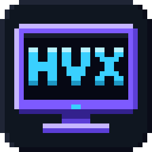
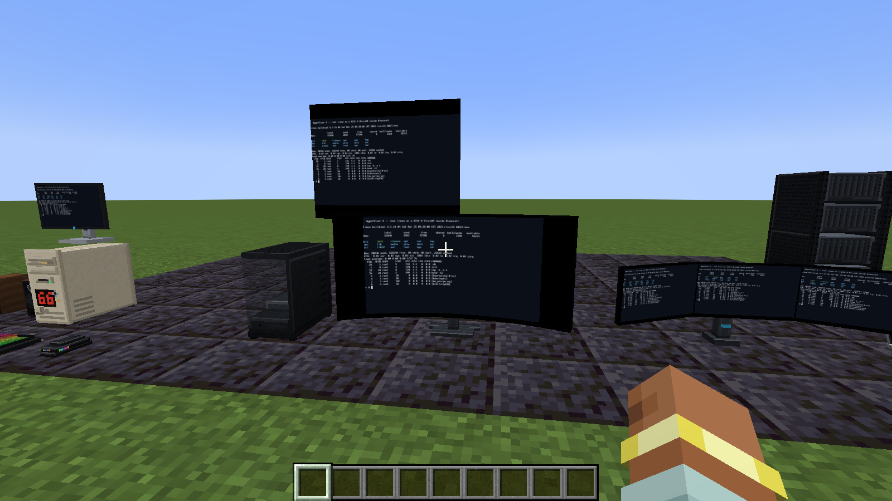
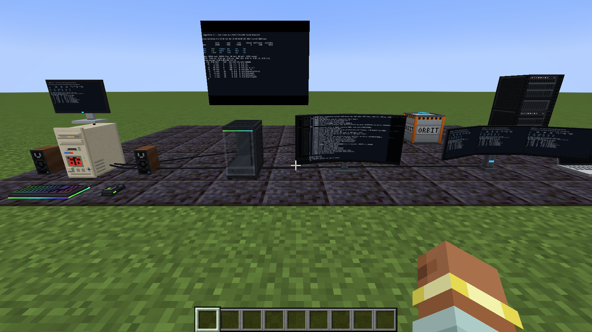
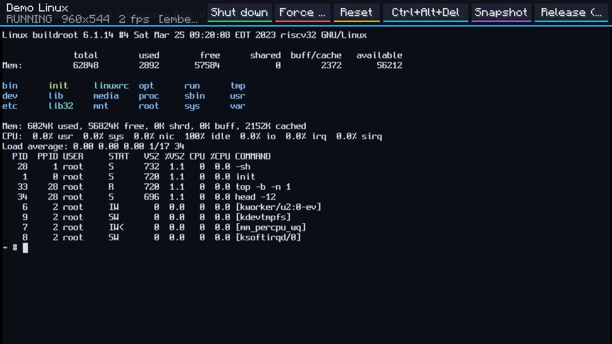
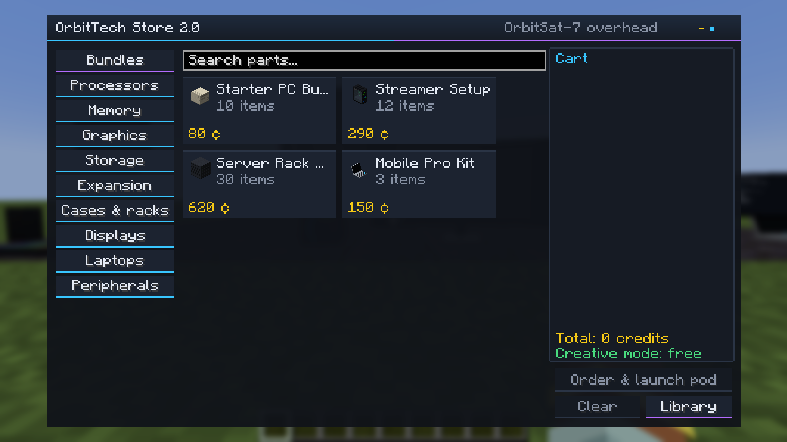
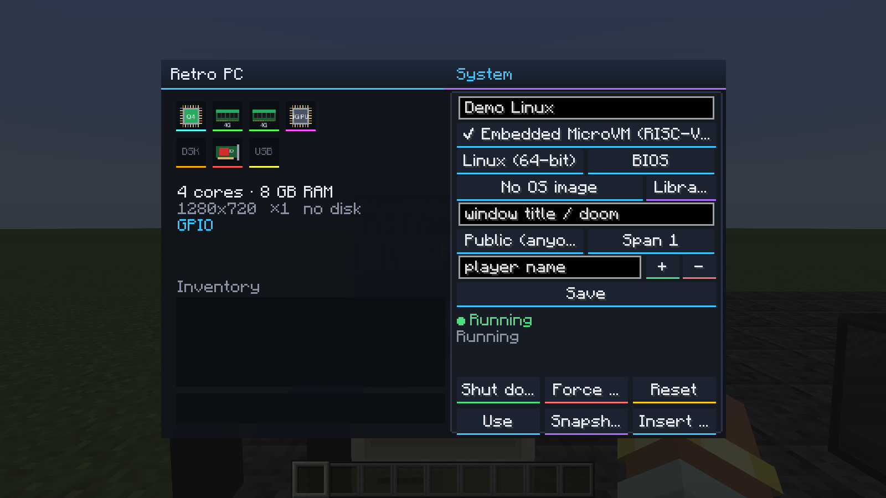

<p align="center"></p>

<h1 align="center">VM Computers: HyperVisor X</h1>

<p align="center">
<b>Real operating systems on real in-game computers, laptops, server racks and video walls.</b><br>
VMware · VirtualBox · QEMU/KVM/WHPX/HVF · zero-install embedded Linux · Minecraft 1.21.1 · NeoForge & Fabric
</p>

<p align="center">
<a href="https://github.com/MosheBarami/vm-computers-hypervisor-x/actions"></a>


</p>



HyperVisor X is a ground-up successor to the legendary **[VM Computers](https://github.com/delta2force/MCVmComputers)**
mod by Delta2Force (2020, archived). You still order parts from a satellite and build a PC block by
block — but the machine now runs on whichever hypervisor you have (or on a built-in RISC-V computer
when you have none), streams to everyone on the server, drives redstone, plays sound into the room
and shows up on monitors, ultrawides, laptops and walls of screens.

---

## Original VM Computers (2020) vs HyperVisor X (2026)

| | VM Computers 1.4 (2020) | **HyperVisor X 1.0 (2026)** |
|---|---|---|
| Minecraft / loader | 1.16.5, Fabric | **1.21.1, NeoForge + Fabric** (Java 21) |
| Hypervisors | VirtualBox 6.1 only (hand-started `vboxwebsrv`) | **VMware Workstation/Player/Fusion, VirtualBox 6.1/7.x (managed web service), QEMU with KVM/WHPX/HVF, embedded RISC-V MicroVM, host window capture** |
| Works with Hyper-V / WSL2 on | often broke | **yes** (QEMU WHPX, VMware on WHP) |
| No hypervisor installed | nothing works | **boots Linux 6.1 in ~1 s on the built-in MicroVM** |
| Where the VM runs | on each player's own PC, one VM per player | **on the world host/server, any number of VMs, shared by everyone** |
| Frame capture | full PNG screenshot in a busy loop that locked/unlocked the session every frame | VNC framebuffer (QEMU, VMware), persistent session + tile diff (VirtualBox), direct rasterizer (MicroVM), GDI `PrintWindow` (capture) |
| Upload to GPU | PNG decode + **new texture every frame on the render thread** | **dirty 64×64 tiles only, through an asynchronous PBO, trilinear mipmaps + anisotropic, sharp-bilinear shader** |
| Multiplayer streaming | whole compressed PNG per frame, relayed through the server, **refused above 32 KB** | **delta-tile codec** (XOR deltas + deflate, optional RGB565), per-player bandwidth budget, late joiners get a full frame, only visible screens are streamed |
| Resolution | whatever the VM window was, blurry | **GPU part decides: 720p, 1080p, 1440p, 4K; span across up to 3 monitors** |
| Audio | none | **positional audio from QEMU guests**, louder through desk speakers |
| Input | relative mouse, Escape-juggling | **absolute mouse, every key goes to the VM (incl. Esc/Tab), dedicated release key** |
| Hardware | 1 case, CPU/RAM/GPU/motherboard, RAM up to 4 GB | Retro PC, **RGB glass tower showing its parts**, **rack cluster up to 64 GB / 32 cores / 4 VMs**, 4 CPUs, 6 RAM sizes, 4 GPUs, HDD/SSD/NVMe/8 TB, USB sticks, GPIO & Wi-Fi cards, blades |
| Displays | CRT, flat screen, wall TV | 24", CRT, **curved 49" ultrawide, dual & triple arms, seamless video walls up to 32×18 blocks** |
| Laptops | — | **Pro & Rugged laptops**: use while walking (picture-in-picture), battery, desk charging, Wi-Fi remote desktop |
| Redstone | — | **GPIO card**: guest programs set/read redstone and move items between chests |
| Store | basic tablet | **OrbitTech Store 2.0**: categories, search, specs, bundles, supply pod landing |
| OS images | copy ISO into a folder | **OS library**: one-click downloads (SHA-256 checked), Windows 10/11 presets, in-game file browser + native dialog, `.iso .img .vmdk .vdi .qcow2 .vhd(x)` |
| Permissions | owner only | private / others can watch / public + trusted players, operator overrides |

---

## Features

### Five engines, one switch
Pick per machine (or leave it on **auto**). Every engine is detected automatically — the
*OS Library → Hypervisors* tab and `/hvx backends` show what was found, its version and whether
hardware acceleration is active.

| Engine | Display / input | Extras | Typical picture rate* |
|---|---|---|---|
| **VMware** Workstation Pro / Player / Fusion | built-in VNC server (localhost, random password) | snapshots, suspend on world close, GPIO via named pipe, USB sticks | 20–30 FPS |
| **VirtualBox** 6.1 / 7.x | managed `vboxwebsrv`, one persistent session, changed tiles only | snapshots, save-state, live ISO swap, GPIO via TCP serial | 10–25 FPS |
| **QEMU** + KVM / WHPX / HVF / TCG | VNC with QEMU extensions (scan codes, audio) | **in-world audio**, snapshots, live ISO swap, NVMe, UEFI (+ swtpm TPM on Linux/macOS) | ~30 FPS (QEMU's VNC refresh) |
| **Embedded MicroVM** (built-in) | pure-Java RV32IMA core + VT220 terminal | zero install, boots Linux 6.1 + BusyBox, DOOM terminal edition, GPIO via escape codes | up to 60 FPS |
| **Host window capture** (Windows) | GDI `PrintWindow`, view only, opt-in | show Discord/VS Code/OBS/a browser on a screen | up to 60 FPS |

\*The streaming pipeline runs at 60 FPS (configurable); what you see is limited by how fast the
engine can produce frames. The rates above are expectations from each engine's capture method;
only the embedded MicroVM was measured for this release. Singleplayer uses an uncompressed in-memory path.

### Computers and parts
- **Retro PC** (desktop case) and **RGB tempered-glass gaming tower** — the GPU, RAM, CPU and
  drives you install are visible through the glass, fans and strips animate when powered.
- **Server rack**: stack up to 8 units; the bottom unit pools all blades (cores + RAM) and drives
  (RAID 0) and runs up to **4 VMs at once** with per-VM CPU/RAM/disk allocation.
- Parts: OrbitCore D2/Q4/X8 and OrbitRipper 16 CPUs · 1–32 GB RAM sticks · integrated, GT (1080p),
  GX (1440p) and Titan (4K, 3 displays) GPUs · 500 GB HDD, 1 TB SSD, 2 TB NVMe, 8 TB enterprise HDD ·
  32 GB **USB flash drive** (a real VMDK that moves between computers and hypervisors) ·
  **Redstone GPIO PCIe card** · **Wi-Fi card** · X8/X16 server blades.
- Right-click a case holding a part to install it instantly, or open it to drag parts into typed slots.
- Breaking a case keeps the parts **and the VM's disk** inside the item.

### Displays
- 24" monitor, CRT, **curved 49" ultrawide**, **dual and triple monitor arms**.
- **Video wall panels** merge automatically into one seamless display (any rectangle up to 32×18).
- Link any display with an **HDMI cable** (use on the computer, then on the display).
  Sneak-use a display to show the left/middle/right part of the desktop — combine with the
  *Span* setting to stretch one desktop over several monitors.

### Laptops
- **Pro Gaming Laptop** (8 cores, 16 GB, 1080p) and **Rugged Toughbook** (4 cores, 8 GB, double battery).
- Hold it and press **V** (or use it in the air) to open; the screen stays visible as
  **picture-in-picture** while you walk or ride.
- Battery drains while running in your hand and charges when the laptop is placed on a surface.
- **Wi-Fi remote desktop**: sneak-use a computer that has a Wi-Fi card to pair; the laptop then
  shows and controls that machine (configurable range).

### Focus mode
Right-click a screen or press **V** while looking at it. The VM fills the window, gets absolute
mouse input and *every* key including Esc and Tab. Press **Right Ctrl** (rebindable) to get back.
The top bar has power, reset, Ctrl+Alt+Del and snapshot buttons, the FPS and the laptop battery.

### OrbitTech Store 2.0
Craft the tablet (iron, glass pane, redstone, copper) and use it outside: browse categories,
search, read specs, buy **bundles** (Starter PC, Streamer Setup, Server Rack Kit, Mobile Pro).
Payment is in credits from your inventory (iron 1, gold 3, emerald 4, diamond 9; free in creative).
A supply pod streaks down from orbit and becomes a delivery crate.

### OS library
Sneak-use the tablet or click *Library* in a computer:
- **Hypervisors** — detection results, versions, acceleration, rescan.
- **Download OS** — Alpine Linux (SHA-256 verified), Tiny Core 16, Debian netinst, FreeDOS 1.4,
  ReactOS, the embedded Linux and DOOM images; KolibriOS and Windows 10/11 open their official
  download pages (Windows presets set UEFI/TPM/RAM for you).
- **Import from PC** — in-game file explorer or the native file dialog (singleplayer / LAN host).
  Disk images (`.vmdk .vdi .qcow2 .vhd .vhdx`) boot as the main disk, ISOs/IMGs as optical media.

---

## Install in 60 seconds

1. Install **Minecraft 1.21.1** with **NeoForge 21.1.x** or **Fabric Loader ≥ 0.16 + Fabric API**.
2. Download `hypervisorx-neoforge-1.21.1-1.0.0.jar` *or* `hypervisorx-fabric-1.21.1-1.0.0.jar`
   from [Releases](https://github.com/MosheBarami/vm-computers-hypervisor-x/releases) and put it in `.minecraft/mods`.
3. Start a world, open the creative tab **VM Computers: HyperVisor X** (or craft the OrbitTech tablet),
   or simply run **`/hvx demo`** to get a complete working showroom.

### Engine quick start
**Embedded (no install)** — set the backend to *Embedded MicroVM* (it is also the automatic
fallback). Power on: Linux boots in about a second and logs you in. Type `doom` in the *Target*
field for the DOOM image.

**VMware** — install VMware Workstation Pro (free for personal use) or Fusion. Nothing else to
configure: HyperVisor X writes the `.vmx`, creates the disk with `vmware-vdiskmanager`, enables
VNC on localhost with a random password and starts the VM headless with `vmrun`.

**VirtualBox** — install VirtualBox 7. HyperVisor X creates the VM with `VBoxManage`, starts
`vboxwebsrv` on `127.0.0.1:18083` by itself and, if logons fail, switches its auth library to
`null` (localhost only; can be disabled in settings).

**QEMU** — Windows: install from qemu.org, enable *Windows Hypervisor Platform* in Windows
Features for WHPX speed (works with Hyper-V/WSL2 on). Linux: install `qemu-system-x86` and add
yourself to the `kvm` group. macOS: `brew install qemu` (HVF). Optional `swtpm` gives Windows 11 a TPM.

Then: build a PC, install CPU + RAM + GPU (+ a drive for real hypervisors), choose an OS image,
press **Power on**, link a monitor with an HDMI cable, right-click the monitor. Done.

---

## Redstone GPIO API

Install the **Redstone GPIO PCIe card**. The guest sees it as its **first serial port**
(`COM1` on Windows, `/dev/ttyS0` on Linux). Send one command per line, read one reply per line.

| Command | Reply / effect |
|---|---|
| `HELLO` | `OK HYPERVISORX-GPIO 1.0 ...` |
| `SET <side> <0-15>` / `SET all <0-15>` | drive redstone on a side |
| `PULSE <side> <0-15> <ticks>` | output for N game ticks, then 0 |
| `GET <side>` | `IN <side> <level>` |
| `GETALL` | `IN down=0 up=0 north=0 south=0 west=0 east=0` |
| `OUT` | current outputs |
| `WATCH on` / `WATCH off` | push `EVT <side> <level>` whenever an input changes |
| `INV <side>` | `INV <side> <size> <slot>:<item>:<count> ...` (chests, barrels, hoppers, furnaces...) |
| `MOVE <from> <to> [count]` | move items between two adjacent inventories → `OK moved N` |
| `TIME` / `WEATHER` | world time / `clear`, `rain`, `thunder` |
| `BEEP [0-24]` | note-block sound at the computer |

Sides: `down up north south west east` or relative `front back left right top bottom`.

**Python (Linux guest)**
```python
import serial, time                      # pip install pyserial
gpio = serial.Serial("/dev/ttyS0", 115200, timeout=1)
def cmd(c): gpio.write((c + "\n").encode()); return gpio.readline().decode().strip()
print(cmd("HELLO"))
while True:                               # blink a lamp on the left of the computer
    cmd("SET left 15"); time.sleep(0.5)
    cmd("SET left 0");  time.sleep(0.5)
```

**PowerShell (Windows guest)**
```powershell
$p = New-Object System.IO.Ports.SerialPort COM1,115200; $p.NewLine = "`n"; $p.Open()
$p.WriteLine("INV north"); $p.ReadLine()
$p.WriteLine("MOVE north south 64"); $p.ReadLine()
```

**Embedded MicroVM** (no second UART): the same commands travel as terminal escape codes; replies
arrive on the terminal input as `ESC ] 1337 ; GPIO ; IN north 15 BEL`.
```sh
printf '\033]1337;GPIO;SET;up;15\a'           # redstone on top of the computer
printf '\033]1337;GPIO;PULSE;front;15;20\a'   # one-second pulse in front
```

---

## Multiplayer, safety and performance
- VMs run on the **server** (or the singleplayer host). Players only receive pixels for screens
  they are looking at, within the screen distance setting.
- Bandwidth per viewer, colour depth (24/16-bit), stream FPS, max running VMs, RAM share of the
  host and what happens on world close (suspend / shutdown / kill) are in `config/hypervisorx-server.json`
  and in the in-game settings screen for operators.
- Every VM has an owner and an access mode; operators can always manage machines.
- Host window capture and importing files from the host disk are restricted to the server
  owner / operators and are off by default on dedicated servers.

## Commands
`/hvx backends` · `/hvx list` · `/hvx info <id>` · `/hvx stop <id> [force]` · `/hvx rescan` ·
`/hvx reload` · `/hvx selftest` (boots a throw-away MicroVM through the real encoder) · `/hvx demo`

## Building from source
```bash
./gradlew build                                   # jars in neoforge/build/libs and fabric/build/libs
./gradlew :common:test -Phvx.bootTest=true -Phvx.testImage=/path/to/Image   # boots real Linux
./gradlew :neoforge:runClient -Phvx.autotest=true  # automated in-game smoke test with screenshots
python tools/gen_assets.py && python tools/gen_lang.py   # regenerate textures, models, languages
```
Requires JDK 21. CI builds both loaders, runs the unit tests and boots Linux on the embedded core
on every push; a `v*` tag publishes a GitHub release and then uploads both jars to Modrinth and
CurseForge when `MODRINTH_TOKEN` / `CURSEFORGE_TOKEN` secrets and `MODRINTH_ID` / `CURSEFORGE_ID`
variables are set (or run *Publish to Modrinth & CurseForge* by hand from the Actions tab).

## Architecture
```
common/                       loader-independent code (≈130 source files, ~17k lines)
  backend/                    HypervisorBackend + qemu/, vmware/, virtualbox/, embedded/, hostcapture/, rfb/, serial/
  vm/                         VmManager (server), VmSession, FrameStream encoder, GPIO bridge, audio conversion
  client/render/              ScreenTexture (PBO streaming), render types, block-entity renderers
  client/screen/              focus, assembly, store, library, file browser, settings, laptop HUD
neoforge/, fabric/            ~5 small classes each: registration, networking, events
tools/                        asset, language and font generators
```

## Known limitations (1.0.0)
- Minecraft **1.21.1** only; ports to the 26.x line are planned.
- The embedded MicroVM is a RISC-V Linux text console, not an x86 PC; Windows needs VMware,
  VirtualBox or QEMU.
- Guest audio is streamed into the world for **QEMU**; VMware and VirtualBox play guest audio on
  the host's speakers.
- No virtual webcam and no Simple Voice Chat bridge yet.
- VMware's VNC server must be supported by your VMware version (Workstation 17 documents it).

## Credits
- **Louis Grünenwald (Delta2Force)** — original VM Computers, the idea and the satellite store.
- **Charles Lohr** — mini-rv32ima, ported to Java for the embedded MicroVM.
- **Frédéric Cambus** — Spleen bitmap font used by the embedded terminal.
- See [NOTICE.md](NOTICE.md) for all licenses. HyperVisor X is free software under the
  **GNU GPL v3.0 or later**, the same license as the original mod.

## Screenshots
| | |
|---|---|
|  |  |
|  |  |
