<p align="center"></p>

# HyperVisor X

A Minecraft mod (1.21.1, NeoForge and Fabric) that adds computers running real operating systems.
It's an unofficial successor to [VM Computers](https://github.com/delta2force/MCVmComputers) by
Delta2Force, which stopped at 1.16.5. I rewrote it from scratch.

[](https://github.com/MosheByte/vm-computers-hypervisor-x/actions)


The VMs run through VMware, VirtualBox or QEMU if you have one of them installed. If you don't,
there's a small built-in RISC-V emulator that boots a Linux console, so it works without installing
anything. VMs run on the server and everyone near the screen sees the same picture.

## Features

- Engines: VMware Workstation/Player/Fusion, VirtualBox 6.1/7, QEMU (KVM, WHPX, HVF), the built-in
  RISC-V Linux VM, and window capture on Windows (view only)
- Retro PC, glass gaming tower that shows the parts you put in, server racks (stack up to 8, run up
  to 4 VMs)
- 24" monitor, CRT, curved ultrawide, dual/triple monitor arms, video walls up to 32x18 blocks
- Laptops with battery, picture-in-picture while you walk around, and Wi-Fi remote desktop to a PC
- USB drives (real VMDK files, you can move them between computers)
- Redstone GPIO card, the guest talks to it over the serial port (see below)
- Sound from QEMU guests plays in the world
- Store tablet: pay with iron/gold/emeralds/diamonds/netherite and the parts get delivered by a
  drop pod. Everything can also be crafted
- OS library with downloads (Alpine, Tiny Core, Debian netinst, FreeDOS, ReactOS) and Windows 10/11
  presets. You can also import your own .iso/.img/.vmdk/.vdi/.qcow2/.vhd(x)
- Windows 10/11 installs unattended on VMware, VirtualBox and QEMU
- Guest tools (VMware Tools, VirtualBox Guest Additions, virtio-win) get installed automatically.
  The wrench icon next to the OS image turns that off
- 3D motherboard view where you put the parts in one by one

## Install

Needs Minecraft 1.21.1 with NeoForge 21.1.200+ or Fabric Loader 0.16+ and Fabric API.
Get the jar for your loader from [Releases](https://github.com/MosheByte/vm-computers-hypervisor-x/releases)
(or Modrinth / CurseForge) and put it in your mods folder.

`/hvx demo` builds a small room with everything already set up.

To build a PC yourself: place a case, put in a CPU, RAM, GPU and a drive, pick an OS image and power
it on. Then connect a monitor with the HDMI cable (use it on the PC, then on the monitor) and right
click the monitor.

### Hypervisors

`/hvx backends` shows what was found.

- Built-in: nothing to install. Pick "Embedded MicroVM" as the engine (it's also the fallback).
  Type `doom` in the Target field if you want DOOM.
- VMware: install Workstation Pro (free, from the Broadcom support portal) or Fusion. The mod writes
  the .vmx, creates the disk and starts the VM headless with vmrun. Tested with Workstation Pro
  26H1u1 on Windows 11 with Hyper-V on.
- VirtualBox: install VirtualBox 7. The mod starts vboxwebsrv on 127.0.0.1:18083 by itself.
- QEMU: on Windows install it from qemu.org and enable Windows Hypervisor Platform. On Linux install
  qemu-system-x86 and add yourself to the kvm group. On macOS `brew install qemu`. Install swtpm if
  you want a TPM for Windows 11.

## Controls

Right click a screen, or look at it and press V. The mouse gets captured and every key goes to the
VM, Esc included.

| Key | |
|---|---|
| Ctrl+Alt | release / capture the mouse |
| Mouse wheel | zoom (Ctrl+Alt+wheel while the mouse is captured) |
| Ctrl+Alt+Enter | full window view |
| Right Ctrl | stop using the computer (rebindable) |

The bar at the top has power, reset, Ctrl+Alt+Del and snapshot buttons.

Right clicking the computer itself opens its screen: parts, settings, OS image, and the motherboard
view.

## Redstone GPIO

With the GPIO card installed the guest sees it as its first serial port (`COM1` on Windows,
`/dev/ttyS0` on Linux). One command per line, one reply per line.

| Command | Reply |
|---|---|
| `HELLO` | `OK HYPERVISORX-GPIO 1.0 ...` |
| `SET <side> <0-15>` / `SET all <0-15>` | set redstone output |
| `PULSE <side> <0-15> <ticks>` | output for N ticks, then 0 |
| `GET <side>` | `IN <side> <level>` |
| `GETALL` | `IN down=0 up=0 north=0 south=0 west=0 east=0` |
| `OUT` | current outputs |
| `WATCH on` / `WATCH off` | sends `EVT <side> <level>` when an input changes |
| `INV <side>` | `INV <side> <size> <slot>:<item>:<count> ...` |
| `MOVE <from> <to> [count]` | moves items between two adjacent inventories, `OK moved N` |
| `TIME` / `WEATHER` | world time / `clear`, `rain`, `thunder` |
| `BEEP [0-24]` | note block sound |

Sides are `down up north south west east` or `front back left right top bottom`.

Python on a Linux guest:
```python
import serial, time  # pip install pyserial
gpio = serial.Serial("/dev/ttyS0", 115200, timeout=1)
def cmd(c): gpio.write((c + "\n").encode()); return gpio.readline().decode().strip()
print(cmd("HELLO"))
while True:  # blink a lamp left of the computer
    cmd("SET left 15"); time.sleep(0.5)
    cmd("SET left 0");  time.sleep(0.5)
```

PowerShell on a Windows guest:
```powershell
$p = New-Object System.IO.Ports.SerialPort COM1,115200; $p.NewLine = "`n"; $p.Open()
$p.WriteLine("INV north"); $p.ReadLine()
$p.WriteLine("MOVE north south 64"); $p.ReadLine()
```

The built-in VM has no second serial port, so there the commands go through terminal escape codes
and replies come back as `ESC ] 1337 ; GPIO ; IN north 15 BEL`:
```sh
printf '\033]1337;GPIO;SET;up;15\a'
printf '\033]1337;GPIO;PULSE;front;15;20\a'
```

## Servers

VMs run on the server (or on the host in singleplayer/LAN), not on each player's PC. Players get
the screens they own or are trusted on, plus anything within `maxWatchDistance`, max 6 streams each.

Limits are in `config/hypervisorx-server.json`: running VMs per player (2), RAM per player (16 GB),
per VM (8 cores, 16 GB), share of host RAM (60%), total VMs (6). Starting VMware/VirtualBox/QEMU
machines needs op by default (`minPermissionForHostBackends`).

Program paths, window capture and the VirtualBox web service settings can only be changed on the
host machine or in the config file, not by ops over the network. QEMU's sockets listen on a private
loopback address and VNC uses a random password per boot. Downloads are checked against SHA-256 and
input is rate limited per player.

VM disks are saved in `<world>/hypervisorx/vms/`.

## Commands

`/hvx backends`, `/hvx list`, `/hvx info <id>`, `/hvx stop <id> [force]`, `/hvx rescan`,
`/hvx reload`, `/hvx selftest`, `/hvx demo`, `/hvx gc <days> [confirm]` (removes VMs whose computer
wasn't loaded for N days)

## Building

JDK 21.
```bash
./gradlew build                                    # jars go to neoforge/build/libs and fabric/build/libs
./gradlew :common:test -Phvx.bootTest=true -Phvx.testImage=/path/to/Image
./gradlew :neoforge:runClient -Phvx.autotest=true
python tools/gen_assets.py && python tools/gen_lang.py
```
Pushing a `v*` tag builds a GitHub release and uploads to Modrinth and CurseForge when the
`MODRINTH_TOKEN` / `CURSEFORGE_TOKEN` secrets and `MODRINTH_ID` / `CURSEFORGE_ID` variables are set.

```
common/      shared code: backends (qemu, vmware, virtualbox, embedded, hostcapture), VM manager,
             streaming, rendering, screens
neoforge/    loader specific stuff
fabric/
tools/       asset, language and font generators
```

## Known issues

- Only 1.21.1 for now
- The built-in VM is a RISC-V Linux console, for Windows you need VMware, VirtualBox or QEMU
- Guest audio only works with QEMU
- VirtualBox uses screenshots, so the frame rate is low. I've only tested VMware and the built-in
  VM against real installs so far
- Your VMware version needs to have its VNC server

## Credits

- Delta2Force (Louis Grünenwald) for the original VM Computers
- Charles Lohr for mini-rv32ima, which the built-in VM is ported from
- Frédéric Cambus for the Spleen font

GPL-3.0-or-later, same as the original. Licenses are in [NOTICE.md](NOTICE.md).

## Screenshots

| | |
|---|---|
| 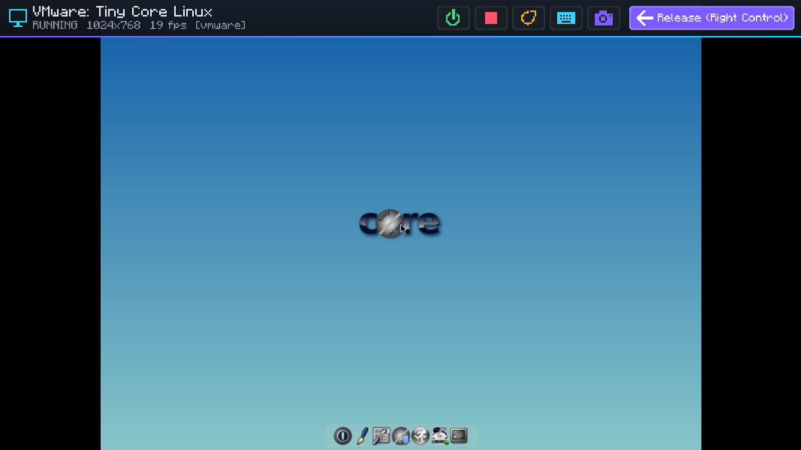 |  |
|  | 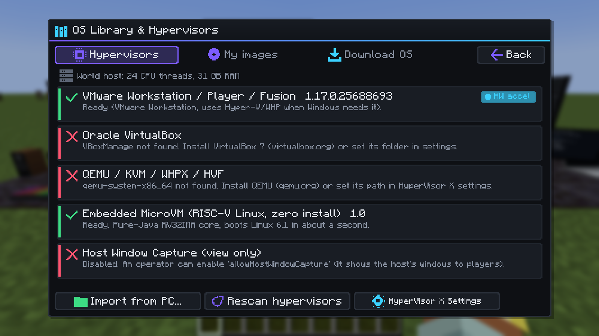 |
|  | 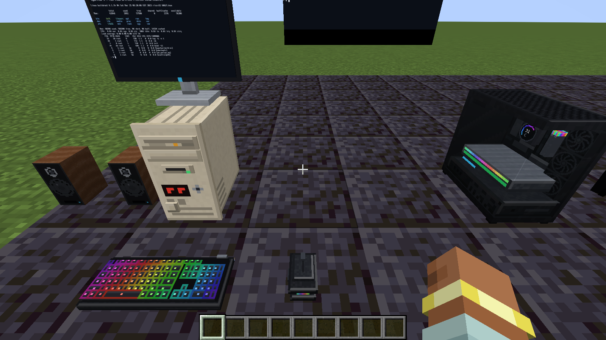 |
|  | 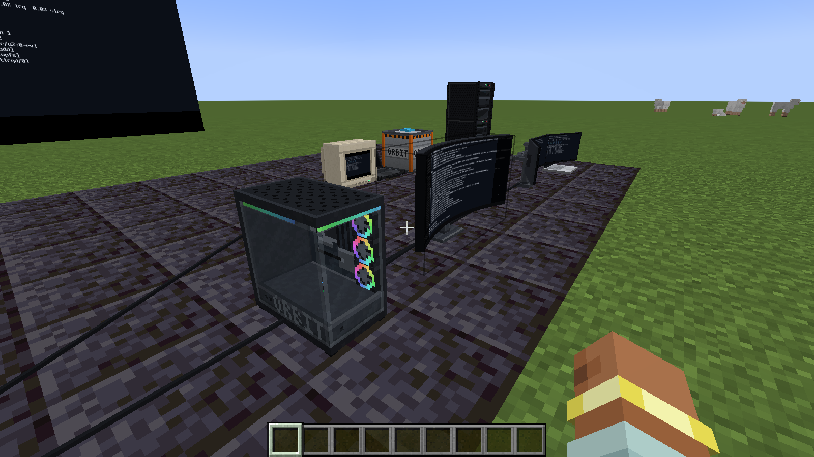 |
| 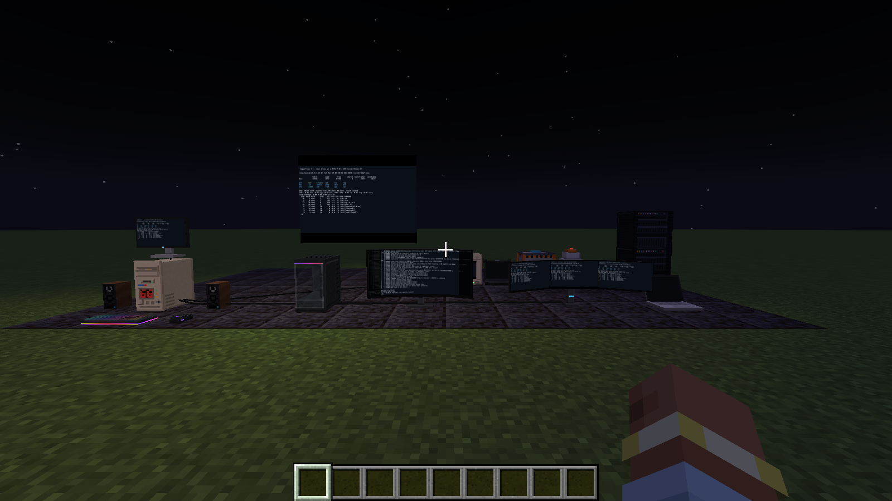 | 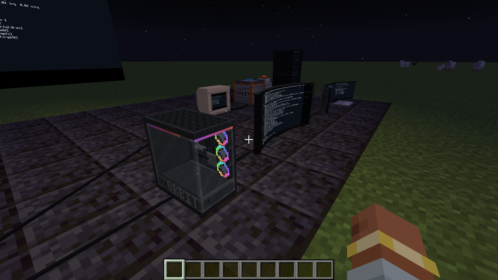 |
| 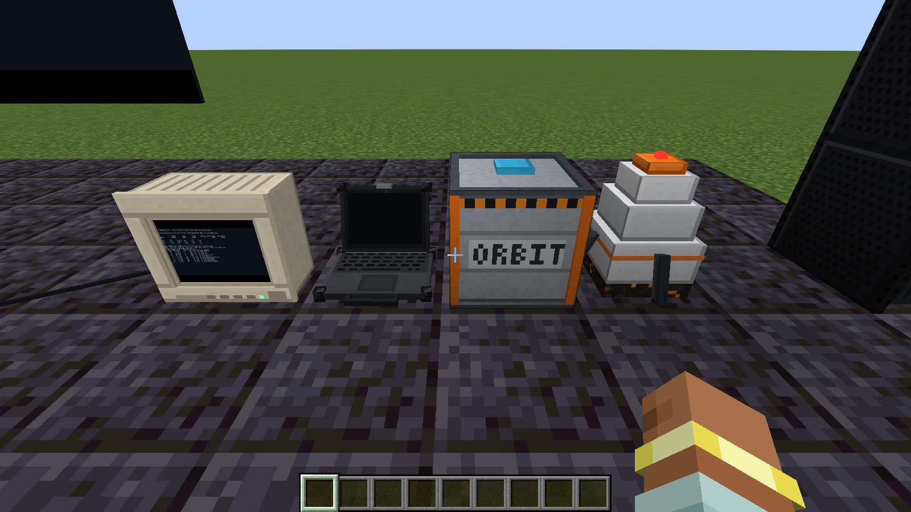 | 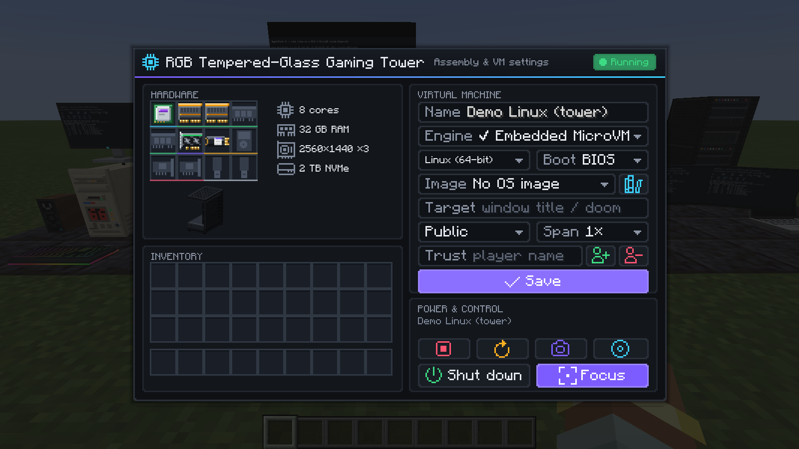 |
| 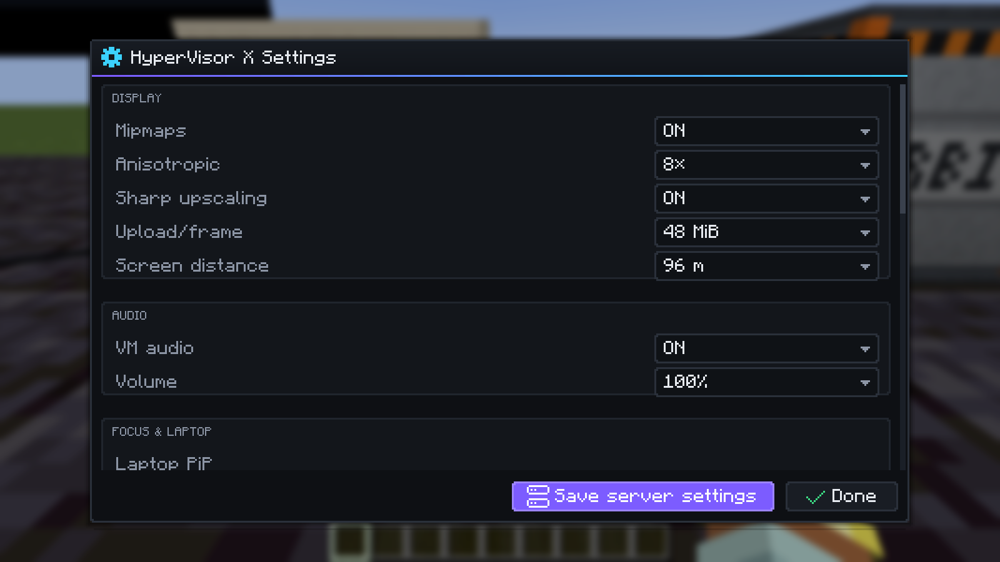 | 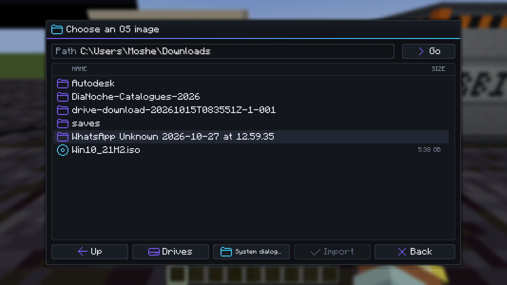 |
| 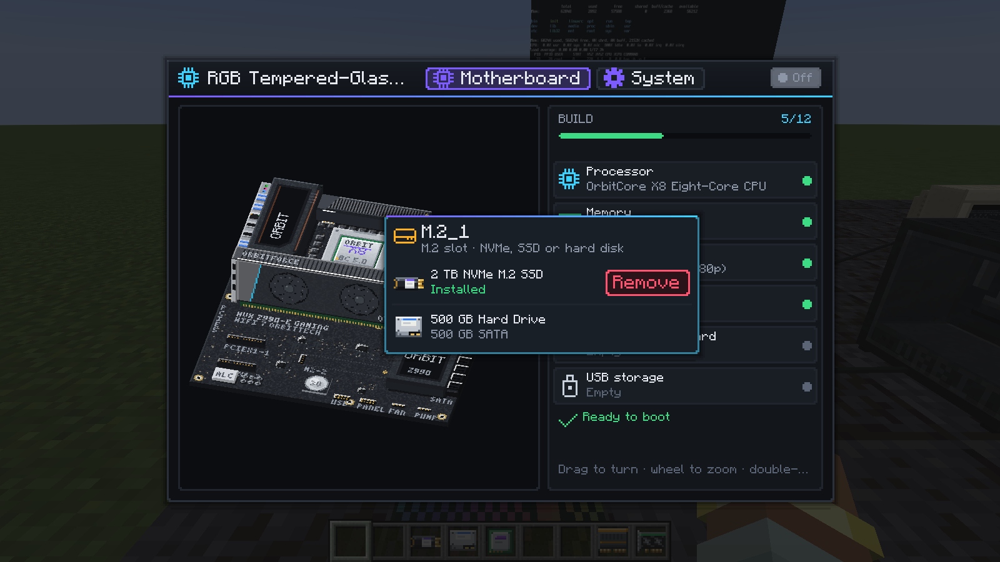 | 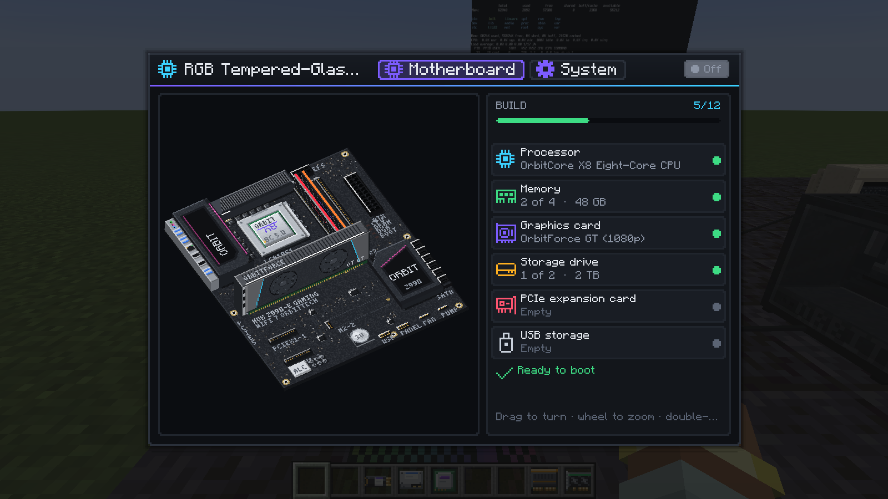 |
| 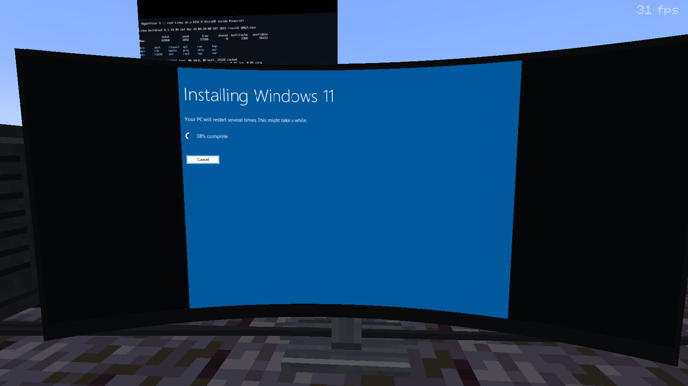 | 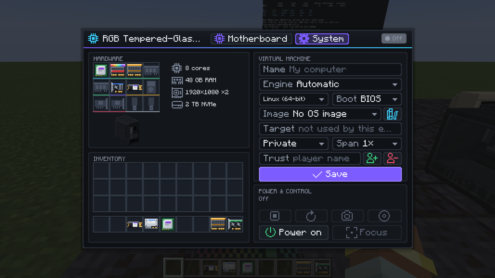 |
